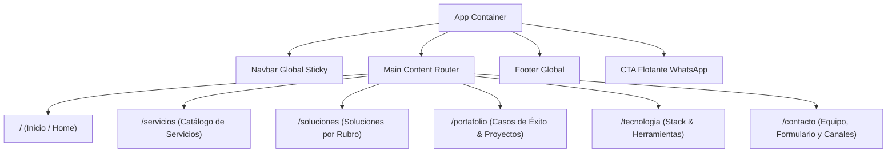

# 📋 Estructura, Servicios y Secciones — CreaPx

Documento técnico y comercial con el detalle completo de la arquitectura web, catálogo de servicios, soluciones sectoriales, casos de éxito y tecnologías de la plataforma **CreaPx** (*Negocios Inteligentes en un Solo Click*).

---

## 🏢 1. Identidad y Propósito

* **Nombre Comercial:** CreaPx
* **Propuesta de Valor:** Automatización de procesos operativos y administrativos, desarrollo de software a medida, soporte de TI e infraestructura física para modernizar y hacer escalar a las empresas sin complicaciones.
* **Stack Principal de la Web:** React 19, Vite, Tailwind CSS, React Router DOM, Lucide Icons, EmailJS.
* **Canales de Atención:** Correo formal (`creapxinnovacion@gmail.com`), formulario web integrado y botón directo a WhatsApp (`+503 7756-2416`).

---

## 🗺️ 2. Esquema de Arquitectura y Navegación (Rutas)

La aplicación cuenta con una arquitectura Single Page Application (SPA) estructurada de la siguiente manera:

### Componentes Globales:
1. **Navbar (`src/assets/components/layout/Navbar.jsx`):**
   * Logo con isotipo redondeado interactivo.
   * Enlaces directos de navegación con resaltado de ruta activa.
   * Menú responsive desplegable para dispositivos móviles.
   * Botón de llamada a la acción (CTA) directo: *"Cotizar"*.
2. **Footer (`src/assets/components/layout/Footer.jsx`):**
   * Resumen de propuesta de valor.
   * Mapa de enlaces rápidos del sitio.
   * Copyright y créditos dinámicos.
3. **ScrollToTop & Analítica (`App.jsx`):**
   * Reposicionamiento automático al tope (`window.scrollTo(0, 0)`) en cada cambio de ruta.
   * Rastreo de vistas de página automáticas con Google Analytics 4 (`window.gtag`).

---

## 🛠️ 3. Catálogo Completo de Servicios

Disponibles en `/servicios`, organizados en tarjetas con insignias de categoría, descripciones y beneficios clave:

| # | Servicio | Insignia | Descripción | Puntos Clave / Beneficios |
|---|---|---|---|---|
| **1** | **Automatización Administrativa** | `Eficiencia` | Elimina tareas manuales y optimiza la productividad del equipo con flujos de trabajo inteligentes. | • Procesos automáticos sin intervención manual. • Reducción drástica de errores operativos. • Ahorro de hasta un 60% de tiempo diario. |
| **2** | **Facturación Electrónica (DTE)** | `Fiscal` | Sistemas homologados y conectados para emisión y recepción de documentos tributarios. | • Cumplimiento legal y normativo vigente. • Generación y reportes automáticos en tiempo real. • Integración directa con software existente. |
| **3** | **Sistemas Web y Móviles** | `Desarrollo` | Software a medida para centralizar la gestión del negocio en una plataforma segura y moderna. | • Apps móviles y portales administrativos a medida. • Sistemas internos personalizados y escalables. • Acceso seguro en la nube desde cualquier dispositivo. |
| **4** | **Digitalización de Documentos** | `Datos` | Transforma papeles y planillas dispersas en bases de datos organizadas y accesibles al instante. | • Generación y extracción de PDFs estructurados. • Plantillas y procesos en Excel automatizados. • Extracción inteligente de datos y gestión de DTE. |
| **5** | **Community Manager & Redes** | `Marketing` | Construye una presencia digital profesional y atrae clientes reales a través de contenido estratégico. | • Estrategia, diseño y calendario de publicaciones. • Campañas publicitarias de alto retorno (Meta y Google). • Gestión de comunidad, comentarios y atención comercial. |
| **6** | **Cámaras de Seguridad & CCTV** | `Seguridad` | Protege instalaciones comerciales o residenciales con monitoreo y grabación continua. | • Instalación de cámaras IP y sistemas DVR analógicos. • Monitoreo remoto en vivo desde el celular. • Mantenimiento correctivo y preventivo de circuitos. |
| **7** | **Climatización de Aire Acondicionado** | `Infraestructura` | Confort térmico y eficiencia energética para oficinas, servidores e instalaciones comerciales. | • Instalación profesional de aires acondicionados. • Mantenimiento preventivo, limpieza y recarga. • Optimización de consumo y flujo de aire. |
| **8** | **Soporte Técnico & Mantenimiento** | `IT Helpdesk` | Asistencia integral en hardware, software y redes para asegurar que la operación nunca se detenga. | • Planes mensuales de soporte preventivo y correctivo. • Instalación de computadoras, pantallas y proyectores. • Configuración de software, redes e impresoras. |

---

## 🎯 4. Esquema de Soluciones por Rubro (Venta Consultiva)

Sección orientada a venta directa por resolución de problemas específicos (`/soluciones`):

1. **Para Microempresas:**
   * **Problema:** Gestión ineficiente de recursos y falta de herramientas digitales accesibles.
   * **Solución:** Plataforma digital personalizada para automatizar procesos y optimizar operaciones.
   * **Beneficios:** Reducción de costos operativos en un 30%, escalabilidad y mayor productividad.

2. **Para Contadores:**
   * **Problema:** Gestión engorrosa de contabilidades complejas y cumplimiento normativo tributario.
   * **Solución:** Software contable automatizado con integración a sistemas fiscales y reportes en tiempo real.
   * **Resultado esperado:** Ahorro de tiempo en procesos contables y reducción de errores en un 50%.

3. **Para Clínicas y Hospitales:**
   * **Problema:** Gestión ineficiente de pacientes y expedientes físicos con riesgo de equivocaciones.
   * **Solución:** Sistema de gestión hospitalaria/médica con historiales electrónicos y módulos interactivos.
   * **Resultado esperado:** Agilidad en la atención de pacientes y optimización de recursos sanitarios.

4. **Para Inmobiliarias:**
   * **Problema:** Dificultad en gestión de propiedades, seguimiento de prospectos y procesos manuales lentos.
   * **Solución:** Plataforma inmobiliaria con CRM integrado y visualización de propiedades.
   * **Resultado esperado:** Mayor conversión de ventas y reducción en tiempos de cierre de transacciones.

5. **Para Empresas Medianas:**
   * **Problema:** Dificultades de escalabilidad y coordinación entre equipos distribuidos.
   * **Solución:** Suite de herramientas empresariales con ERP y colaboración en la nube.
   * **Resultado esperado:** Eficiencia operativa unificada y crecimiento sostenible.

---

## 🏆 5. Casos de Éxito y Proyectos del Portafolio

Proyectos desarrollados y desplegados documentados en `/portafolio`:

| Proyecto | Rubro / Sector | Problema Resuelto | Solución Técnica Implementada | Stack Tecnológico |
|---|---|---|---|---|
| **API Agente Contable 🚀** | Finanzas & Contabilidad SaaS | Procesamiento ágil y seguro de DTE en arquitectura multi-tenant sin degradar rendimiento. | Backend modular con FastAPI y SQLAlchemy ORM, autenticación JWT encriptada con Bcrypt y endpoints estructurados. | FastAPI, Python, SQLAlchemy, PostgreSQL, Neon DB, JWT, SQLite |
| **Panel Médico de Control e Impresión 🏥** | Salud & Clínicas | Descontrol de expedientes, agendamiento de citas y emisión manual propensa a errores. | App web con UI Glassmorphism, control de citas con semaforización de expedientes y generador de recetas PDF en alta fidelidad (2.5x). | HTML5, CSS3 Vanilla, Bootstrap 5, SweetAlert2, html2pdf.js, JavaScript |
| **Control de Inventario de Botiquín 📦** | Logística & Inventarios | Pérdida financiera por caducidad de fármacos y dificultad para conciliar costos. | App en React + TypeScript sincronizada con Google Sheets vía Google Apps Script con motor dual: FEFO (físico) y PEPS (financiero). Contenedorizado en Docker / K8s. | React, TypeScript, Google Apps Script, Google Sheets, Docker, Kubernetes, GitHub Actions |
| **Gas Flama ⚡** | Distribución & Transporte | Coordinación ineficiente de pedidos de cilindros de gas y falta de ubicación satelital en tiempo real. | App móvil y web en Flutter con arquitectura BLoC/Cubit, rastreo satelital con OpenStreetMap, geolocalización en background y WebSockets. | Flutter, BLoC / Cubit, OpenStreetMap, WebSockets, Geolocator, JWT |
| **CreaPx - Recolector de Facturas ⚙️** | Automatización & Desktop | Horas hombre perdidas extrayendo facturas XML/JSON y PDF de correos. | Software de escritorio con PySide6 (Qt) multihilo (QThread), escaneo IMAP autónomo, validación de licencias y almacenamiento en Neon DB. | Python, PySide6 (Qt), IMAP / Gmail, PostgreSQL, Neon DB, QThread, Cryptography |
| **Mantenimiento de Computadoras 💻** | Soporte Técnico & Hardware | Calentamiento, polvo acumulado, fallas de hardware y lentitud de PCs operativas. | Mantenimiento preventivo/correctivo profundo, cambio de pasta térmica, optimización de SO y diagnóstico de componentes (con galería interactiva de fotos). | Diagnóstico, Limpieza Física, Pasta Térmica, Optimización SO, Mantenimiento Preventivo |

---

## 💻 6. Stack Tecnológico de CreaPx

Detallado en la sección `/tecnologia`:

* **Frontend, Móvil y Escritorio:** React, TypeScript, JavaScript (ES6+), Flutter (Móvil/Web), PySide6 (Qt Desktop), HTML5 / CSS3 Vanilla, Tailwind CSS, Bootstrap 5, Astro, Bulma, C# ASP.NET, WPF / WinForms, Java JSP, PHP.
* **Backend & Lógica de Negocio:** FastAPI (Python), Python 3, Node.js, Cloudflare Workers, Google Apps Script, Laravel (PHP), Java Spring Boot, WebSockets, QThread (Multihilo), SQLAlchemy ORM, BLoC / Cubit.
* **Bases de Datos & Almacenamiento:** PostgreSQL, Neon DB (Serverless), MySQL, SQL Server, SQLite, Google Sheets (Cloud API), MongoDB, Firebase.
* **Integraciones & Seguridad:** JWT (Auth & Tokens), EmailJS, APIs IMAP / Gmail, OpenStreetMap, Facturación Electrónica (DTE), REST APIs (JSON/XML), Cifrado Criptográfico, Generación de reportes Excel / PDF.
* **Infraestructura & DevOps:** Docker, Docker Compose, Kubernetes (Kustomize), GitHub Actions (CI/CD), Vercel (Hosting Web), Cloudflare (CDN & Edge Workers).
* **Operaciones, Soporte & Infraestructura Física:** Cámaras de Seguridad IP, Sistemas DVR y Analógicos, Mantenimiento preventivo/correctivo de Hardware, Climatización y Aire Acondicionado, Ventilación, Estrategia de Community Manager.

---

## 👥 7. Equipo y Canales de Contacto

Detallado en la sección `/contacto`:

### Equipo de Liderazgo:
1. **Javier Hernández** — *CEO y Director de Ventas*
2. **Armando Cua** — *Community Manager*
3. **Cristian Cajul** — *IT & Desarrollo*

### Métodos de Contacto:
* **Formulario Interactivo:** Validación de entradas en tiempo real (nombre, email y mensaje) con envío a través de EmailJS.
* **Correo Directo:** `creapxinnovacion@gmail.com`
* **Botón Flotante WhatsApp:** Enlace directo interactivo (`wa.me/50377562416`).

