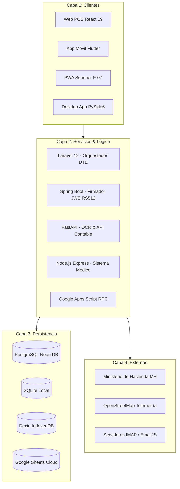

# 📐 SDD-JR-001 · Software Design Document (SDD)
## Desarrollador JR — Cristian Cajul & Equipo Multidisciplinario
> **Versión:** 2.0 (Reestructurada)  
> **Fecha de Revisión:** Noviembre, 2026  
> **Estado:** ● Vigente en Producción  
> **Organización:** CreaPx El Salvador  
> **WhatsApp Directo:** +503 7035 2834  
> **Estándar:** Adaptado de IEEE 1016 / ISO/IEC/IEEE 42010  

---

## 📋 Control del Documento

| Campo | Valor |
|---|---|
| **Código del Documento** | `SDD-JR-001` |
| **Versión** | `2.0` |
| **Fundador & Dirección Técnica** | Cristian Cajul |
| **Equipo Multidisciplinario** | 6 Especialistas (Desarrollo, CCTV, Soporte IT, Administración, Gestión, Logística) |
| **Organización** | CreaPx El Salvador |
| **Clasificación** | Especificación Técnica de Ingeniería & Portafolio de Producción |
| **Módulos Cubiertos** | 10 Módulos de Software (Web, Móvil, Desktop, Microservicios) |

---

## 1. Introducción y Marco Operativo

### 1.1 Propósito
Este Software Design Document (SDD) establece la especificación técnica formal de los sistemas diseñados, codificados y desplegados por **Cristian Cajul** y el equipo de **Desarrollador JR** en **CreaPx**. Documenta la arquitectura de microservicios, contratos de API, algoritmos de cálculo tributario y resiliencia offline implementados en proyectos reales.

### 1.2 Alcance
Abarca 10 módulos de software en producción: facturación electrónica homologada por el Ministerio de Hacienda (MH), lectura con OCR para el libro de compras F-07, expediente médico interactivo, control de inventarios farmacéuticos con motor dual, recolección automatizada de comprobantes por IMAP, conversión masiva de DTEs a hojas de cálculo, APIs multi-inquilino y despacho logístico satelital.

### 1.3 Glosario Técnico y Normativo
* **DTE:** Documento Tributario Electrónico homologado por el Ministerio de Hacienda de El Salvador.
* **MH / DGII:** Ministerio de Hacienda / Dirección General de Impuestos Internos de El Salvador.
* **F-07 / Anexo 3:** Declaración e informe mensual de compras y crédito fiscal en formato plano CSV de 21 columnas sin encabezados.
* **JWS RS512:** Token JSON Web Signature compacto firmado con algoritmo RSA y hash SHA-512 (clave de 4096 bits).
* **FEFO:** *First Expired, First Out* (Primero en vencer, primero en salir) para la rotación física del inventario.
* **PEPS:** *Primeras Entradas, Primeras Salidas* para la valorización contable y financiera de salidas.
* **QThread:** Manejo de concurrencia y tareas asíncronas en segundo plano en el framework Qt/PySide6.

---

## 2. Matriz de Trazabilidad: Servicios CreaPx ↔ Módulos de Software

| Servicio Comercial CreaPx | Enfoque de Negocio | Módulos Técnicos que lo Soportan | Especialista Responsable |
|---|---|---|---|
| **Automatización Administrativa** | Supresión de trabajo manual y flujos desatendidos. | `MOD-05` Recolector, `MOD-06` P&G Contadores, `MOD-04` Botiquín | Cristian Cajul & Ricardo Cuellas |
| **Facturación Electrónica (DTE)** | Emisión legal, firma digital JWS y sello de Hacienda. | `MOD-01` SVFE, `MOD-02` Libro F-07, `MOD-07` API Contable | Cristian Cajul |
| **Sistemas Web y Móviles** | Plataformas a medida con alta disponibilidad. | `MOD-03` Panel Médico, `MOD-08` Gas Flama, `MOD-09` Web CreaPx | Cristian Cajul |
| **Digitalización de Documentos** | Extracción automatizada, OCR y salida en PDF/CSV. | `MOD-02` Libro F-07, `MOD-05` Recolector, `MOD-03` Panel Médico | Cristian Cajul & Ricardo Cuellas |
| **Community Manager & Redes** | Conversión, analítica y presencia de marca. | `MOD-09` Web Institucional CreaPx | Julio Hernández |
| **Cámaras de Seguridad & CCTV** | Infraestructura de monitoreo continuo y redes IP. | Infraestructura Física y Redes | Enmanuel Sánchez |
| **Climatización y A/C** | Eficiencia térmica y confort para servidores y oficinas. | Infraestructura Física | Gerardo Tepas |
| **Soporte Técnico & Hardware** | Mantenimiento preventivo, pasta térmica y optimización. | `MOD-10` Mantenimiento de Hardware | Gerardo Tepas & Eduardo Zúñiga |

---

## 3. Perfil del Fundador y Equipo Multidisciplinario

### 3.1 Fundador: Cristian Cajul
Arquitecto de soluciones, líder de desarrollo y formador técnico. Con experiencia en orquestación de sistemas tributarios para el Ministerio de Hacienda de El Salvador (JWS RS512), modernización de procesos operativos y arquitectura de datos relacionales.

#### Especialidades Acreditadas del Fundador:
1. **Desarrollo:** Backend (FastAPI, Laravel, Node), Frontend (React 19) y Móvil (Flutter).
2. **Soporte IT:** Mantenimiento físico y lógico de infraestructura.
3. **Redes y estructura de redes:** Cableado estructurado, subredes, VLANs y routers.
4. **Cámaras:** Sistemas de videovigilancia y circuitos cerrados IP.
5. **Auxiliar eléctrico:** Instalaciones eléctricas seguras para centros de cómputo.
6. **Auxiliar administrativo:** Optimización de procesos contables y operativos.
7. **Profesor de desarrollo:** Formación de nuevos talentos en programación.
8. **Capacitador de ofimática:** Entrenamiento corporativo en suites de productividad.
9. **ETL y transformación de datos:** Pipelines de datos, normalización y extracción automatizada.

### 3.2 El Equipo Detrás de Desarrollador JR (6 Integrantes)
1. **Cristian Cajul** — *Fundador · Desarrollo:* Dirección de ingeniería, backend y firma JWS.
2. **Enmanuel Sánchez** — *Cámaras y alarmas:* CCTV IP/DVR, control perimetral y alarmas.
3. **Gerardo Tepas** — *Soporte IT:* Mantenimiento preventivo de hardware, pasta térmica y helpdesk.
4. **Ricardo Cuellas** — *Asistencia administrativa:* Gestión de comprobantes, flujos contables y trazabilidad.
5. **Eduardo Zúñiga** — *Soporte y gestión:* Operaciones en campo, tickets y asistencia en redes.
6. **Julio Hernández** — *Ventas y logística:* Atención comercial, prospección y logística de entregas.

---

## 4. Arquitectura Global del Ecosistema

---

## 5. Catálogo Detallado de los 10 Módulos

* **MOD-01:** SVFE · Facturación Electrónica (Laravel 12 + Spring Boot JWS RS512 + Dexie.js).
* **MOD-02:** Libro de Compras F-07 (FastAPI + PaddleOCR + React PWA + CSV 21 columnas DGII).
* **MOD-03:** Sistema Médico Glassmorphism (Node.js + Express + Neon PostgreSQL + html2pdf 2.5x).
* **MOD-04:** Control de Inventario Botiquín (React 19 + TypeScript + Google Sheets API + FEFO/PEPS).
* **MOD-05:** CreaPx Recolector de Facturas 2026 (PySide6 Qt + QThread + IMAP SSL + Licencia SHA-256).
* **MOD-06:** P&G Contadores (React 19 + SheetJS xlsx + Parser masivo de JSON DTE).
* **MOD-07:** API Agente Contable Multi-Tenant (FastAPI + SQLAlchemy + JWT con nitEmpresa).
* **MOD-08:** Gas Flama (Flutter + BLoC + OpenStreetMap + WebSockets).
* **MOD-09:** Plataforma Institucional CreaPx (React 19 + Vite + Tailwind + EmailJS + GA4).
* **MOD-10:** Mantenimiento Preventivo Hardware (Soporte TI + Pasta Térmica Conductiva).

---

## 6. Canales Directos & Contacto

* **WhatsApp Empresarial:** `+503 7035 2834` (https://wa.me/50370352834)
* **Correo Directo:** `creapxinnovacion@gmail.com`
* **Fundador:** Cristian Cajul
* **Organización:** CreaPx El Salvador — *Desarrollador JR: Desarrollo & Automatización*
